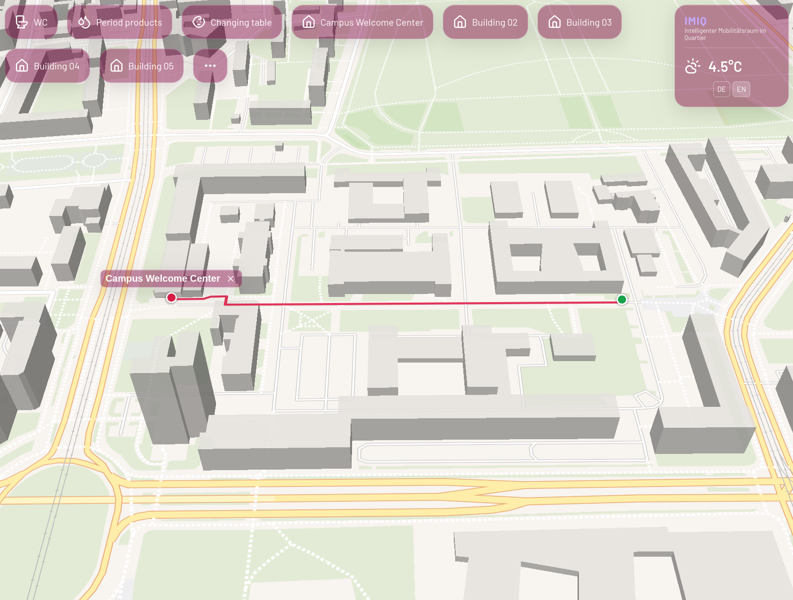

# OVGU Campus Finder



OVGU Campus Finder is a bilingual (German and English) interactive map for the
Otto von Guericke University Magdeburg campus. It helps visitors find campus
buildings, accessible routes, restrooms, menstrual products, and changing
tables. The map also displays current weather and provides a QR code for
sharing a selected destination.

## Features

- Browse campus buildings using the map, quick links, or the full building list.
- Get walking routes to buildings and nearby facilities.
- Switch between German and English; the app also detects the browser language.
- Share a destination by scanning its QR code.
- Use URL parameters to open a language, map configuration, or destination
  directly.

## Requirements

- Node.js 26 and npm for local development.
- Docker for building and running the production image.

## Run locally

```sh
cd frontend
npm ci
npm run dev
```

Vite prints the local development URL when the server starts.

## Available scripts

Run these commands from `frontend/`:

| Command | Description |
| --- | --- |
| `npm run dev` | Start the Vite development server. |
| `npm run build` | Type-check and create a production build in `frontend/dist/`. |
| `npm run preview` | Preview the production build locally. |
| `npm run lint` | Run Oxlint. |

## Production with Docker

Build the image from the repository root and run it with:

```sh
docker build -t campus-finder .
docker run --rm -p 8080:80 campus-finder
```

Then open `http://localhost:8080`. The image builds the frontend and serves the
static site with Nginx. The GitHub Actions workflow builds the image for pull
requests and publishes it to GitHub Container Registry for pushes to `main`
and version tags.

## URL parameters

- `lang=de` or `lang=en` selects the interface language. Without this parameter,
  the app uses the browser language and falls back to English.
- `configName=main` or `configName=pfaelzer` selects a configured initial map
  view. An unknown value uses `main`.
- `destination=<value>` opens a destination when the app loads. Building values
  use the building's German name; the special values `restroom`,
  `period-products`, and `changing-table` open the nearest matching facility.

For example:

```text
/?lang=en&configName=main&destination=restroom
```

Destination links are also generated by the app when a destination is selected.

## Campus data and services

- Building and room data is loaded from [`frontend/public/pois.json`](./frontend/public/pois.json).
  Building entries include German and English names, coordinates, and optional
  room records. Room `type` values beginning with `restroom`, `menstrual-product`,
  or `changing-table` are used for facility searches.
- Initial map views are defined in
  [`frontend/src/assets/configs.json`](./frontend/src/assets/configs.json).
- The map tiles and style are provided by OpenFreeMap. Walking directions and
  weather are fetched from the IMIQ services configured in the frontend.
  These features require network access; the routing and weather services are
  external to the static site.

## License

This project is distributed under the MIT License. See [`LICENSE`](./LICENSE).
